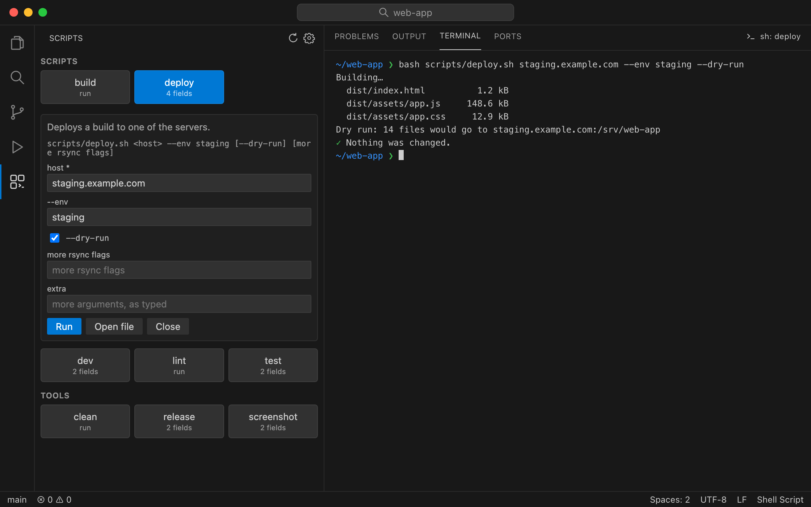
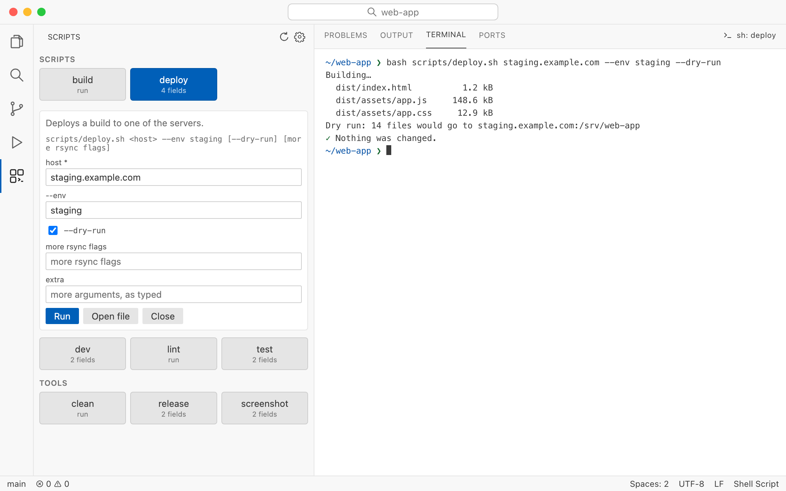

# Shell Script Buttons

Every `.sh` script in your workspace as a button in the sidebar. Click one to run it in its own terminal from the
workspace root.



If a script needs arguments, clicking it opens fields for them instead, read from the usage line in its header comment:

```sh
#!/bin/bash
# Rebuilds one map.
#
#   tools/build_map.sh <map_id> [--fast] [more args]
```

| In the usage line | Field |
|---|---|
| `<name>` | required text field |
| `word` | text field filled in with `word` |
| `--flag value` | text field for the flag's value |
| `[--flag]` | checkbox |
| `[anything else]` | optional text field (a leading `--flag` is kept in front of what you type) |
| `res://tools/<scene>.tscn` | field for `scene`, put into the word |

Every script also gets an **extra** field for anything else. Right-click a button to open its fields even when it
would run straight away. What you typed is remembered.

Scripts whose header says "run as root" or "run as postgres" never run on a single click: they open with a warning.



## Hiding folders

`shButtons.exclude` (the gear at the top of the panel) is a list of glob patterns to leave out. By default:
`**/.claude/**`, `**/build/**`, `**/dist/**`, `**/vendor/**`, `**/.import/**`. `node_modules`, `.git` and `.godot` are
always left out.

```json
"shButtons.exclude": ["**/.claude/**", "deploy/**"]
```

## Source

Open source under the MIT licence: [github.com/kahlery/vs-code-extensions/shell-script-buttons](https://github.com/kahlery/vs-code-extensions/tree/main/shell-script-buttons).
Issues and pull requests are welcome [there](https://github.com/kahlery/vs-code-extensions/issues).
